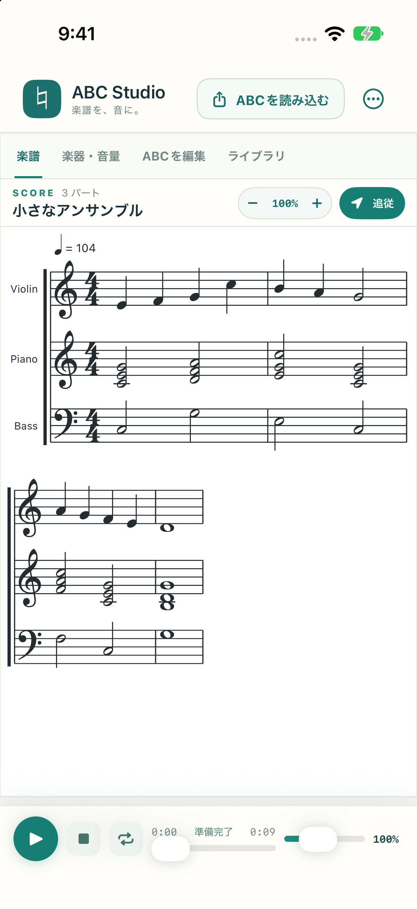

# ABC Studio

ABC notation → sheet music → playback. A native, offline iPhone / iPad app.

[紹介ページ](https://porarrirr.github.io/abc-studio/) · [サポート](https://porarrirr.github.io/abc-studio/support.html) · [プライバシー](https://porarrirr.github.io/abc-studio/privacy.html)



ABC 記譜法のファイルを読み込み、楽譜を表示して再生する iPhone / iPad アプリです。

## 主な機能

- `.abc` / `.txt` の読み込み、複数曲が入ったファイルの曲選択、ABC テキストの編集、最後に開いた楽譜の復元
- Files やメールなど他アプリからの「このアプリで開く」(`.abc` 独自 UTI 登録)、クリップボードからの読み込み、アプリ内サンプル(`Samples/`)
- オーケストラ・ジャズ・現代クラシック向けの78種類の楽器割り当て（[対応一覧と音色の範囲](docs/instruments.md)）
- `V:` で定義した複数パートへの個別の楽器割り当てと同時再生
- 「楽器・音量」タブでパートごとの音量を0–100%に調節、ミュート・ソロ、マスター音量（音量は再生中にも変更可能）
- 再生・一時停止・停止・シーク・ループ・速度変更（50–200%、スライダー）
- 音符タップでその位置へシーク
- SMuFL フォント(Bravura)による譜面描画、パート間で同時に鳴る音符を縦に揃えるレイアウト、ズーム(ボタン・ピンチ)
- 再生中の音符の色付けと再生位置の列表示、段ごとの自動追従(譜面ヘッダーの「追従」で ON/OFF。再生中に指でスクロールすると一時停止し「再生位置へ戻る」で再開。一時停止は iOS 18 以降)
- ロック画面・コントロールセンターの再生操作と Now Playing 表示、バックグラウンド音声
- 割り込み(電話・Siri)とオーディオルート変更への対応、アイドル時のエンジン停止
- エディタの下書き自動保存、入力中のバックグラウンド検証
- アプリ内ライブラリ(「ライブラリ」タブ): 表示中の曲を保存し、一覧から開いて再生。長押しで名前変更・削除

## 書き出し・共有(右上メニュー)

- ABC ソースの保存・共有
- 楽譜の PNG / PDF 書き出し
- MIDI (SMF) 書き出し
- 演奏の WAV オフラインレンダリング(バックグラウンド処理)

## 対応する ABC 記法(演奏)

タイ、グレースノート、連符、装飾音(トリル・モルデント・ロール/アルペジオ)、スタッカート、フェルマータ(テンポマップのディップとして全パート同期して延長)、クレッシェンド/デクレッシェンドのヘアピン(ベロシティ補間)、反復記号 `|: :|` と番号付き括弧 `|1 |2 |3…`、声部ごとの打楽器パート。P:(演奏順)と `&` による声部分割は現在未対応です。

合唱は General MIDI の `Choir Aahs` 音色であり、歌詞を発声する音声合成ではありません。ドラムは General MIDI の打楽器音程配置を使います。`Samples/drum-kit.abc` を参照してください。

## ビルド

Xcode で `ABCStudio.xcodeproj` を開き、`ABCStudio` スキームと iPhone / iPad Simulator を選んで実行します。Swift Package / CocoaPods 等の外部ライブラリは不要です。iOS / iPadOS 17以降に対応します。検証時の環境はXcode 27.0 / iOS 27.0 Simulatorです。

```sh
git clone https://github.com/porarrirr/abc-studio.git
cd abc-studio
open ABCStudio.xcodeproj
```

実機・App Store用の署名チームは各自のApple Developerアカウントを設定してください。チームID・証明書・認証キーはリポジトリに含めません。プロジェクト設定を再生成する場合は [XcodeGen](https://github.com/yonaskolb/XcodeGen) を別途導入して `xcodegen generate` を実行します。設定の原本は `project.yml` です。

## テスト

- `ABCStudioTests`: パーサー・診断・リピート展開(複数番号括弧)・ビーム(スペース切断)・テンポマップ・フェルマータ・装飾の演奏化・MIDI・楽器推測・楽譜エクスポートの単体テスト
- `ABCStudioUITests`: 起動・譜面表示・タブ遷移・再生・停止のスモークテスト(スクリーンショットは `/tmp/uitest-*.png`)

```sh
xcodebuild -project ABCStudio.xcodeproj -scheme ABCStudio \
  -destination 'platform=iOS Simulator,name=iPhone 17 Pro' \
  -derivedDataPath .derived test
```

デバイス名は `xcrun simctl list devices available` の環境に合わせて変更してください。
公開前の検証結果・申請状況は [release/STATUS.md](release/STATUS.md) を参照してください。
テンポ変換処理の性能測定と再現手順は [docs/performance.md](docs/performance.md) にまとめています。

## 構成とライセンス

ABC の解析・診断・譜面描画・再生はすべて Swift / SwiftUI / CoreGraphics / AVAudioEngine で実装したネイティブコードで、WebView や JavaScript は使用していません。オフラインの音色は FluidR3_GM サウンドフォント(MIT)から AVAudioUnitSampler でノートごとにレンダリングした AAC サンプルで、サウンドフォント本来のベロシティ応答・サステイン・自然減衰を含みます。譜面記号は Steinberg の Bravura フォント(SIL Open Font License 1.1、`Sources/Fonts/Bravura-OFL.txt`)を同梱して描画します。音色のライセンスと帰属表示は `SoundFont/SOUNDFONT-ATTRIBUTION.md`、アプリ内では右上メニューの「このアプリについて」を参照してください。

音色を再生成するには `FluidR3_GM.sf2` を用意して `scripts/render_soundfont.sh <sf2のパス>` を実行します。

アプリの独自ソースコード・ドキュメント・アートワークは [MIT License](LICENSE) です。音色はFluid (R3)のMIT、BravuraはOFL 1.1を保持します。[THIRD_PARTY_NOTICES.md](THIRD_PARTY_NOTICES.md) に同梱素材の出典と条件をまとめています。利用者の楽譜の権利は利用者に帰属し、このソフトウェアライセンスから他者の楽曲を利用する権利が付与されるわけではありません。

## データとプライバシー

アプリは楽譜や利用状況を開発者へ送信せず、広告・解析SDK・トラッキング機能を含みません。下書き・設定とアプリ内ライブラリはデバイス内に保存します。ユーザーが選んだ共有先、Appleのバックアップ、Webサイト、問い合わせメールは各サービスの取り扱いに従います。必要理由APIの宣言は `Sources/PrivacyInfo.xcprivacy` に含まれています。

## Webサイトと公開資料

- `docs/index.html`: 紹介・マーケティング
- `docs/support.html`: サポート・FAQ
- `docs/privacy.html`: プライバシーポリシー
- `docs/style.css`: 外部ライブラリ・外部フォント不要の共通スタイル
- `release/`: App Storeメタデータと掲載画像の作成記録

ローカル確認は `python3 -m http.server 8000 --directory docs`、GitHub Pagesは `main` の `/docs` を公開元にします。公開済みであることと、App Store審査の完了は別です。正確な進捗は `release/STATUS.md` に記録します。

## お問い合わせ・参加

- 共通窓口: [musicabc@rarari.org](mailto:musicabc@rarari.org)
- サポート: [support@rarari.org](mailto:support@rarari.org)
- プライバシー: [privacy@rarari.org](mailto:privacy@rarari.org)

3つの宛先はドメイン所有者の既存キャッチオールで受信します。新規メールアカウントやパスワードは作成しません。
公開してよい不具合・改善はGitHub Issuesへ。参加方法は [CONTRIBUTING.md](CONTRIBUTING.md)、脆弱性の私的報告は [SECURITY.md](SECURITY.md) を参照してください。
